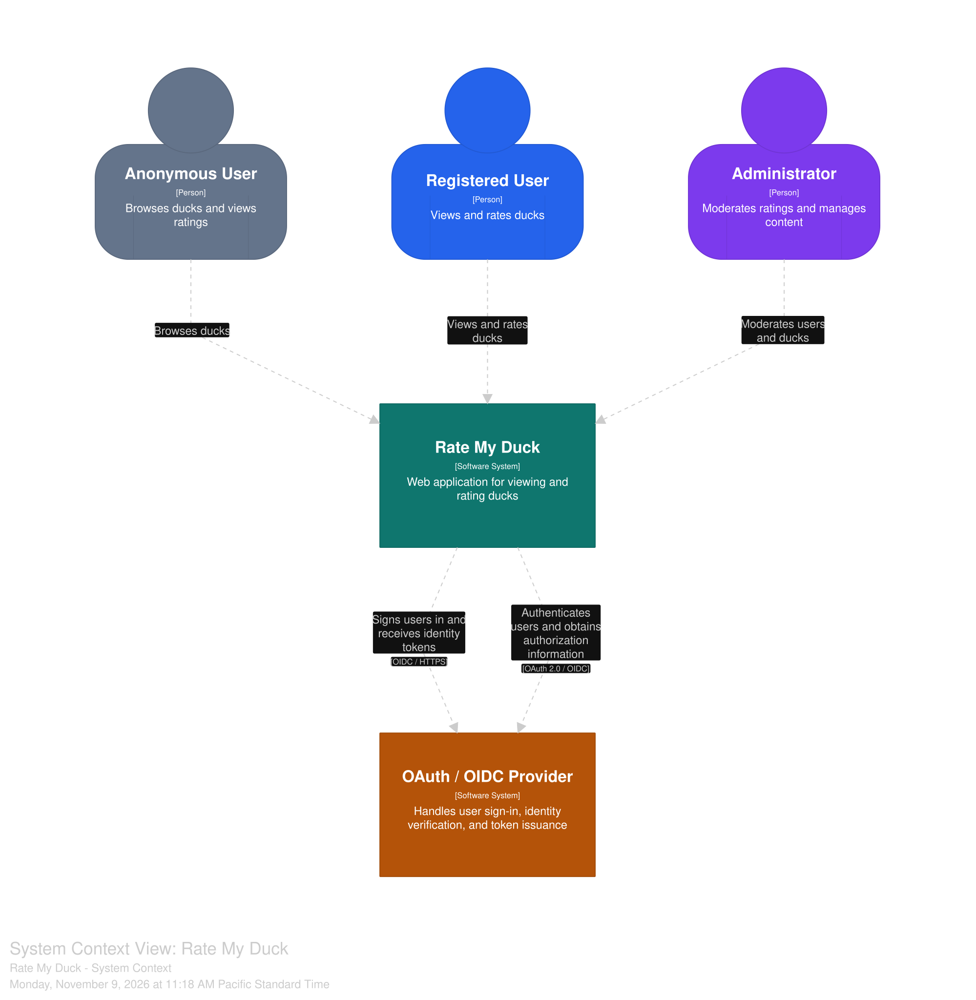
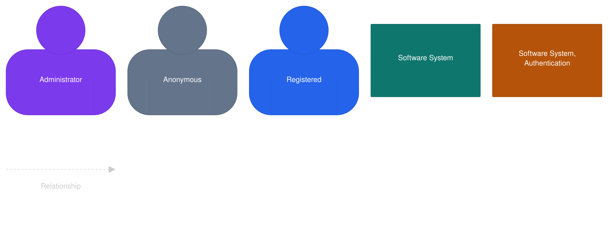
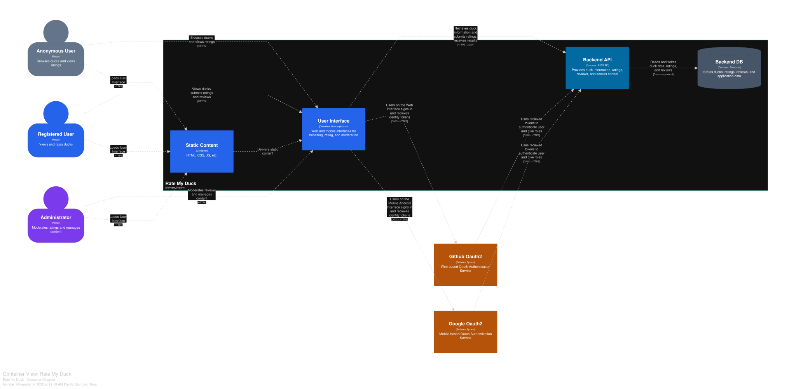
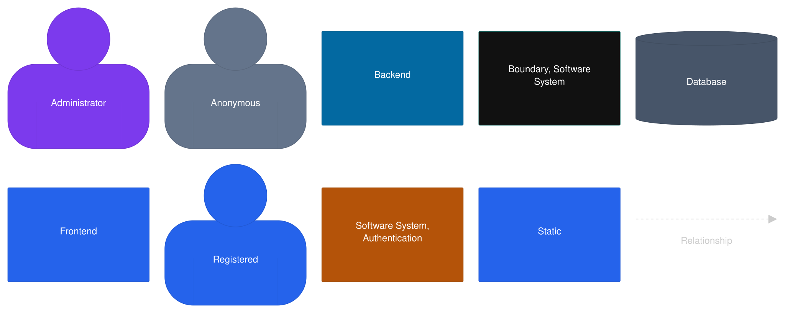
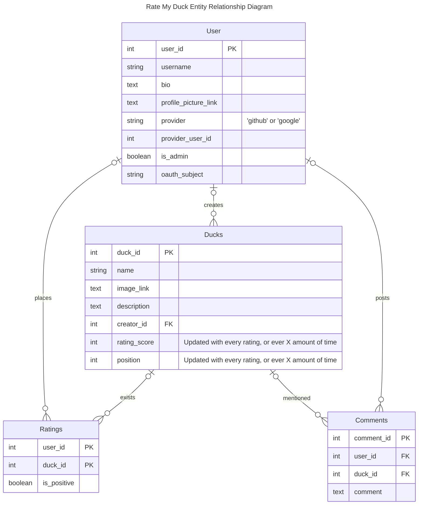

# System Architecture Layout
The C4 Model diagrams were created using structurizer, use the provided architexture.dsl file with the tool officially provided by structurizer.

The tool is dockerized and can be run locally, quick start guide can be found [here](https://docs.structurizr.com/local/quickstart).

## C4 Model
### System Context Diagram

### Container Diagram

## ERD
